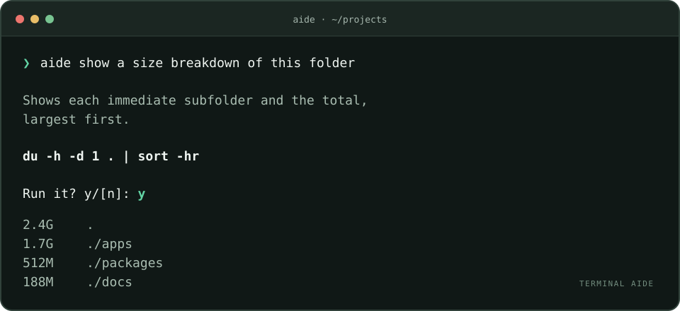

<div align="center">

<h1>Terminal Aide</h1>

<p><strong>Plain English → Bash → your confirmation.</strong></p>

<p>
<a href="https://www.npmjs.com/package/@chester-hill-solutions/terminal-aide"></a>
<a href="https://github.com/chester-hill-solutions/terminal-aide/actions/workflows/ci.yml"></a>
<a href="https://nodejs.org/"></a>
<a href="LICENSE"></a>
</p>

<p>A small, open-source terminal assistant powered by
<a href="https://openrouter.ai/cohere/north-mini-code:free">North Mini Code</a> through OpenRouter.</p>

<p>
<a href="#quick-start">Quick start</a> ·
<a href="#usage">Usage</a> ·
<a href="#saved-rules">Saved rules</a> ·
<a href="#execution-and-privacy">Execution &amp; privacy</a> ·
<a href="https://github.com/chester-hill-solutions/terminal-aide/blob/main/.github/CONTRIBUTING.md">Contribute</a>
</p>



<p><sub>Illustrative session. Commands are generated for each request.<br>A temporary spinner clears when the proposal is ready.</sub></p>

</div>

| Preview the plan | Keep the final say | Make it yours |
| :--- | :--- | :--- |
| Read the explanation and complete Bash command. Use `--dry-run` for a proposal only. | Explicit `y/[n]` confirmation. Enter cancels. No automatic approval flag. | Save global and project rules, selected locally within an 8-rule / 2,000-byte budget. |

## Quick start

Install, add your [OpenRouter API key](https://openrouter.ai/settings/keys), and ask:

```bash
npm install --global @chester-hill-solutions/terminal-aide
export AIDE_OPENROUTER_API_KEY='your-openrouter-key'
aide give me a size breakdown of the current folder
```

**Requires Node.js 22+, macOS or Linux, and `/bin/bash`.** Bring your existing terminal, SSH configuration, and command-line tools. The model is [`cohere/north-mini-code:free`](https://openrouter.ai/cohere/north-mini-code:free); endpoint availability and request limits depend on OpenRouter.

<details>
<summary><strong>API key setup and running without an install</strong></summary>

Add the export to your shell configuration if you want it available in future terminal sessions. Aide reads the environment variable; it does not load `.env` files. Keep the key out of source control.

The [environment variable reference](https://github.com/chester-hill-solutions/terminal-aide/blob/main/docs/environment.example) lists the supported key variables.

`AIDE_OPENROUTER_API_KEY` is specific to Aide and takes precedence over the shared `OPENROUTER_API_KEY` variable. If the Aide-specific variable is unset or blank, Aide falls back to `OPENROUTER_API_KEY`.

If your key is already saved in a plain-text file, load it without putting its value in your shell configuration:

```bash
export AIDE_OPENROUTER_API_KEY="$(< "$HOME/.config/terminal-aide/openrouter-key")"
```

You can also run it without a global installation:

```bash
npx --package=@chester-hill-solutions/terminal-aide aide --dry-run "list the largest files in this folder"
```

</details>

## Usage

```bash
aide list the 10 largest files in downloads
aide scp to 192.0.2.38 the newest file in downloads to documents/frank
aide "find .log files modified in the last week"
aide --dry-run "show which process is listening on port 3000"
aide
```

With no arguments, Aide prompts for a request. If an essential detail is missing, it asks a follow-up question. Review the explanation, full command, paths, and warnings before typing `y` (`yes` also works). At `Run it? y/[n]:`, Enter, `n`, `no`, Ctrl-C, or Ctrl-D cancels. There is no automatic approval flag. `--dry-run` only displays and checks the proposal. The spinner and bold styling are omitted from redirected output; `TERM=dumb` disables animation, and `NO_COLOR` disables color and bold.

Your shell processes the request before Aide receives it. **Quote requests containing special characters** such as `*`, `$`, backticks, `;`, `>`, `&`, or `|` so the shell does not expand or execute those characters itself. Use single quotes when you want literal `$` or backticks.

## Saved rules

Save standing preferences in plain language:

```bash
aide --rules use zipgrep for search
aide --rules "show sizes in human-readable units"
aide --rules --when search "prefer ripgrep"
aide --rules --when transfer "prefer rsync"
aide --rules --always "use metric units"
aide --rules --project --when packages "use pnpm"
aide --rules                         # List rules with their numbers
aide --rules --remove 1              # Remove rule 1
aide --rules --clear                 # Remove all rules
aide --rules --project               # List this project's rules
aide --rules --project --remove 1    # Remove a project rule
aide --rules --for "search source"   # Inspect the rules that would be sent
```

Global rules are saved in `~/.config/terminal-aide/rules.json`, or `$XDG_CONFIG_HOME/terminal-aide/rules.json` when that variable names an absolute directory. Project rules are saved in `.aide/rules.json` at the project root and also apply from subdirectories. The nearest Git repository defines the root; without Git, Aide uses the nearest `package.json`, `pyproject.toml`, `Cargo.toml`, or `go.mod`. An existing nearer `.aide/rules.json` defines a narrower scope. A nested repository or separate manifest project does not inherit an outer project's rules. Outside a recognized project, adding project rules uses the current directory.

Rule selection happens locally, with no extra model call. Existing plain-language rules still work: recognizable tool/task preferences are matched to relevant requests. Unknown preferences and negative constraints remain general. Use `--always` to make a rule general explicitly, or `--when` to set conditions. Built-in topics are `search`, `transfer`, `sizes`, `archive`, `network`, `process`, `git`, `packages`, and `math`. Comma-separated conditions match any listed topic; custom conditions match words in the request. Follow-up answers can activate additional relevant rules. This is deterministic topic/keyword matching, so `--rules --for` is the way to check a particular phrasing.

At most **8 rules and 2000 UTF-8 bytes** of rule JSON are sent per request. Exact duplicates are removed. All applicable general rules are retained; if those alone exceed the budget, Aide reports an error asking you to shorten or scope them. Remaining space goes to relevant project preferences first, then newer global preferences, without truncating instruction text. Inspection shows active rules, their scope, the byte count, and how many were skipped as unrelated, duplicates, or over budget. Normal command previews stay concise.

The files are JSON arrays you can edit directly. Existing string entries use automatic topic matching; explicit conditions use objects, for example:

```json
[
  "use zipgrep for search",
  { "text": "use metric units", "when": ["general"] },
  { "text": "prefer rsync", "when": ["transfer"] }
]
```

Managing and inspecting rules works without an API key. Project rules take precedence over global rules; newer rules take precedence within a scope, and a specific instruction in the current request takes precedence over saved preferences. A tool preference applies to tasks that tool supports—for example, `zipgrep` searches inside ZIP archives. Rules guide generation rather than mechanically rewriting shell commands, and execution still requires `y`.

## Example: copy the newest download

```bash
aide scp to 192.0.2.38 the newest file in downloads to documents/frank
```

Aide proposes a command to select the newest regular file in `~/Downloads` and copy it to the remote directory with `scp`. Review the paths and any overwrite warning before confirming.

- “Newest” means most recently modified regular file directly inside the local `~/Downloads` folder, including hidden files. Directories are excluded, and an empty folder should stop the command.
- `192.0.2.38:documents/frank/` is a directory relative to the remote user's home. Paths are case sensitive; `documents` and `Documents` may differ. This is a documentation address; substitute your server's address.
- SSH uses your configured/default username when you omit one. Specify `as frank` or `frank@192.0.2.38` if needed.
- The destination directory must already exist. SSH/scp can prompt for host verification, a password, or a key passphrase after you confirm.
- A generated command chooses the newest file when it runs, so files arriving between preview and confirmation can change the selection.

## Execution and privacy

Aide uses exactly [`cohere/north-mini-code:free`](https://openrouter.ai/cohere/north-mini-code:free) through OpenRouter's Chat Completions API. It uses a proposal-only function tool and validates the returned data locally. The model cannot run tools or commands. There is no fallback to a different model. OpenRouter [rate limits free models](https://openrouter.ai/docs/api/reference/limits); availability and limits can change.

Aide also accepts a complete JSON proposal returned as plain text, applying the identical schema and terminal-control checks. If the model returns unstructured text or malformed tool-call JSON, Aide makes one additional request with the same model under the original timeout. Every accepted proposal passes the same confirmation flow. Authentication failures, rate limits, and rejected unsafe content fail immediately.

Each request sends only your request, follow-up answers, selected rules, operating system, working directory, and home directory to OpenRouter and the model provider. Rules are loaded from the global configuration and the current project's `.aide/rules.json`; project discovery checks marker paths without reading source files. Aide does not read other project file contents, directory listings, shell history, or SSH configuration during generation. Do not include secrets in your requests or rules. The API key is used only in the authorization header. Both `AIDE_OPENROUTER_API_KEY` and `OPENROUTER_API_KEY` are removed from the generated command's environment. Aide stores no history or request logs.

Before confirmation, Aide rejects malformed responses and hidden terminal control characters and checks Bash syntax with `bash -n`. It requires interactive stdin, stdout, and stderr for execution, so piped `yes` cannot approve a command. Input arriving between questions is discarded. Preview mode works without a terminal when the request is supplied as arguments.

After confirmation, the exact displayed command runs with your user's permissions and inherited terminal in a fresh `/bin/bash --noprofile --norc -o pipefail -c` process. Bash startup hooks and exported functions are removed. This is **not a sandbox**: a confirmed command can delete or overwrite files, send data, or invoke sudo. Syntax checks and model warnings do not prove correctness. Review the command itself.

Commands inherit your current directory and usual environment (apart from the API key and Bash hooks). A `cd` command affects the child process only; it cannot change the parent terminal's directory. The CLI returns the executed command's exit code. A declined proposal returns zero; errors return one; a process-level interruption returns 130. Aide does not retry failed commands automatically.

## Development

```bash
git clone https://github.com/chester-hill-solutions/terminal-aide.git
cd terminal-aide
npm ci --ignore-scripts
npm test
npm run check
npm run pack:check
npm link
```

Tests use mocked OpenRouter responses and real local Bash processes. They cover explicit confirmation, preview mode, clarification, invalid responses, API failures, cancellation, piped input, startup-hook isolation, and exit codes. They do not contact OpenRouter or perform real network transfers.

See the [contributing guide](https://github.com/chester-hill-solutions/terminal-aide/blob/main/.github/CONTRIBUTING.md) for development, repository layout, and releases; the [security policy](https://github.com/chester-hill-solutions/terminal-aide/blob/main/.github/SECURITY.md) for private vulnerability reporting; and the [changelog](https://github.com/chester-hill-solutions/terminal-aide/blob/main/docs/CHANGELOG.md) for release notes. Contributions and reproducible bug reports are welcome.

If your environment maps `@chester-hill-solutions` to GitHub Packages, this package uses the public npm registry instead. The repository's `.npmrc` sets the correct mapping for source installs; a tagged GitHub release also includes an installable npm tarball.

## License

[MIT](LICENSE). Built by [Chester Hill Solutions](https://github.com/chester-hill-solutions), open to everyone.

<div align="center">

[Report a bug](https://github.com/chester-hill-solutions/terminal-aide/issues/new?template=bug_report.yml) · [Request a feature](https://github.com/chester-hill-solutions/terminal-aide/issues/new?template=feature_request.yml) · [Release notes](https://github.com/chester-hill-solutions/terminal-aide/releases)

</div>
